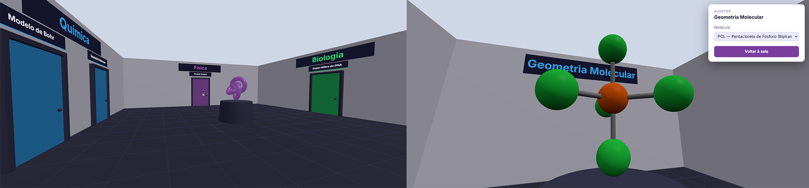
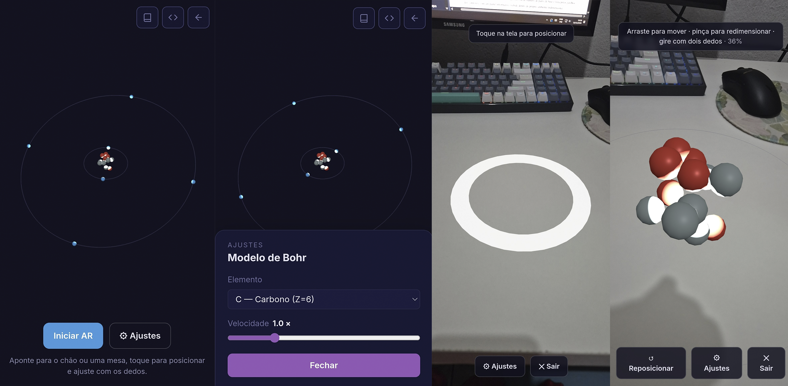
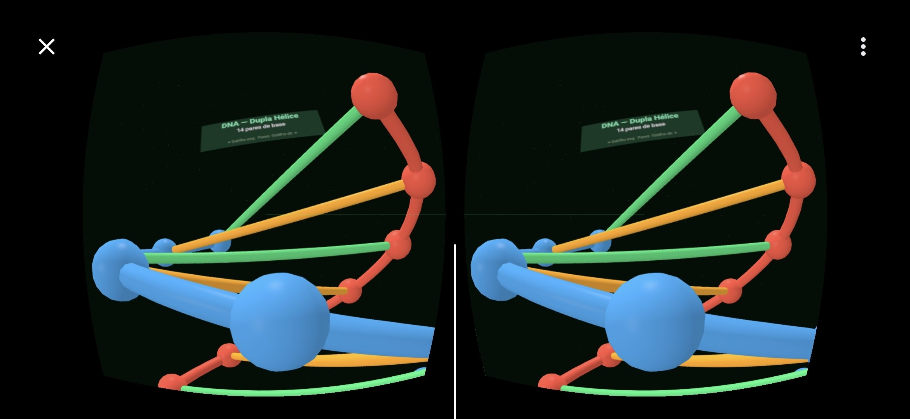
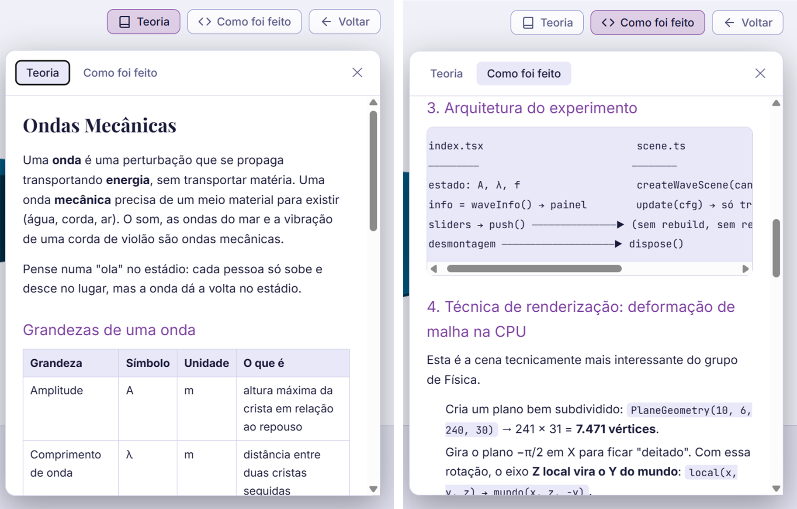
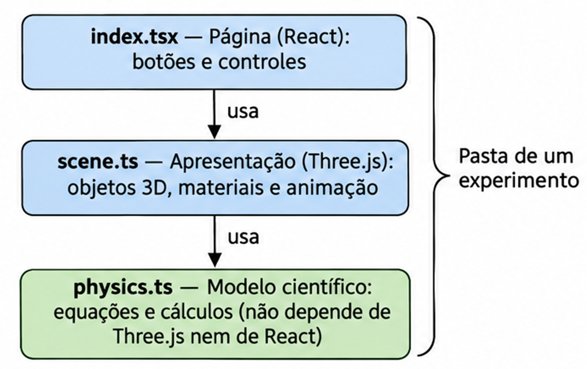
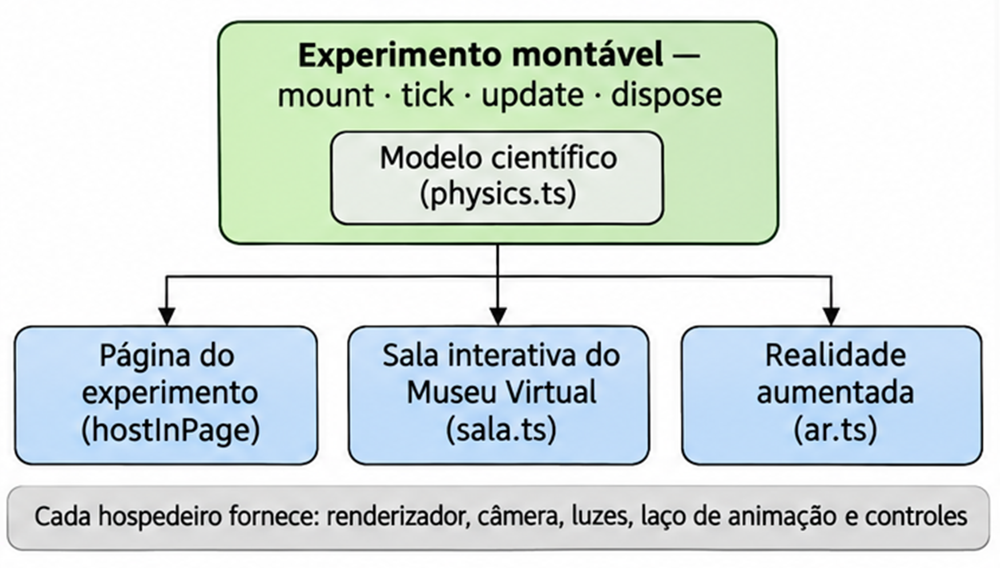
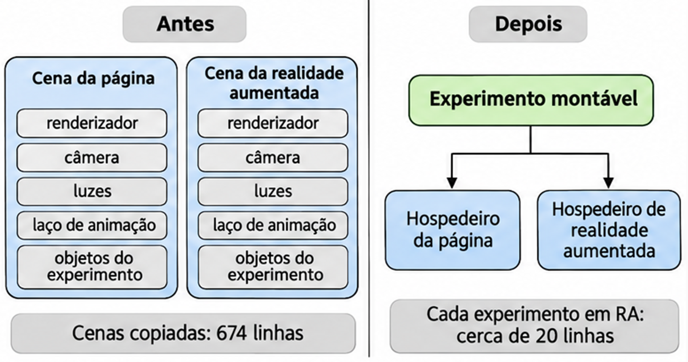
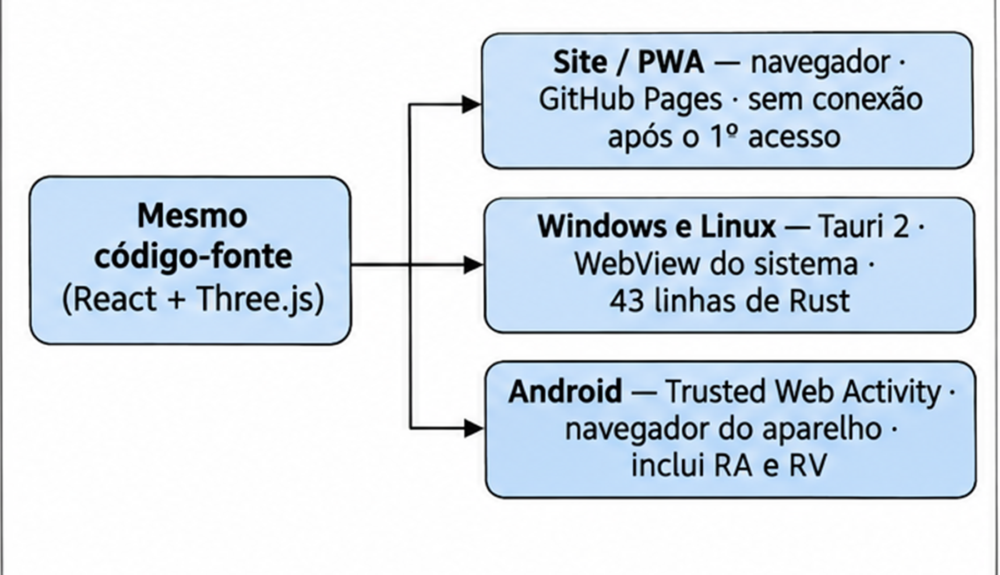

# CLARA.js

**Centro de Laboratórios para Aprendizagem e Representação Analítica** — uma plataforma web de laboratórios virtuais de Física, Química e Biologia, desenvolvida como Trabalho de Conclusão de Curso (TCC) em Ciência da Computação.

Os experimentos rodam inteiramente no navegador, sem instalação e sem servidor: no computador, no celular, em realidade aumentada, em realidade virtual e com interação por gestos pela webcam.

Site publicado: https://darlan-ferreira1.github.io/CLARA.js/









## Downloads

O CLARA.js também pode ser **instalado** e usado **sem internet**. As versões ficam na página de [**Releases**](https://github.com/darlan-ferreira1/CLARA.js/releases/latest).

| Sistema | Arquivo | Observações |
|---|---|---|
| **Windows** | `CLARA_<versão>_x64-setup.exe` (ou o `.msi`) | Tudo do site, offline desde a instalação. A realidade aumentada e a virtual imersiva ficam no site, porque não existem no PC. |
| **Linux** | `.AppImage` (qualquer distribuição) ou `.deb` (Debian/Ubuntu) | Igual ao Windows. AppImage: `chmod +x` no arquivo e depois executá-lo. |
| **Android** | `.apk` | Tudo do site, **inclusive a realidade aumentada e a virtual**. Abre no navegador do celular (Chrome ou outro compatível). Offline depois do primeiro uso. |
| **Navegador** | — | No Chrome ou no Edge, use **"Instalar app"** na barra de endereço. Offline depois do primeiro acesso. |

> Os instaladores não têm assinatura digital paga. No Windows, o SmartScreen pode mostrar "O Windows protegeu o computador": clique em **Mais informações → Executar assim mesmo**. No Android, permita a instalação de apps de fontes desconhecidas.

## A proposta

A contribuição do trabalho para a Ciência da Computação é a **arquitetura de software** da plataforma: uma forma de organizar experimentos científicos para que **o mesmo modelo** funcione em diferentes formas de apresentação e de interação. O site é a prova de conceito dessa arquitetura.

## Como explorar

| Modo | O que é |
|---|---|
| **Galeria** | Todos os experimentos em cards, com busca e filtro por área. Cada experimento tem controles de parâmetros e dois botões: **Teoria** (o conteúdo para o aluno) e **Como foi feito** (a documentação técnica). |
| **Museu Virtual** | O **Museu CLARA.js**: um ambiente 3D em primeira pessoa (WASD + mouse no computador, joystick na tela do celular). Cada porta leva à **sala interativa** de um experimento, onde ele aparece em tamanho real e pode ser ajustado (Tab / ⚙). |

## Experimentos

| Área | Experimento | Modalidades |
|---|---|---|
| Física | Pêndulo Simples | Página · Sala interativa |
| Física | Lançamento de Projétil | Página |
| Física | Sistema Solar | Página |
| Física | Ondas Mecânicas | Página |
| Física | **Você é o Móvel** (cinemática com a mão) | Webcam (MediaPipe) |
| Química | Modelo de Bohr | Página · Sala interativa · VR · AR |
| Química | Geometria Molecular (VSEPR) | Página · Sala interativa · AR |
| Química | **Lei de Boyle com as Mãos** | Webcam (MediaPipe) |
| Biologia | Dupla Hélice de DNA | Página · Sala interativa · VR · AR |
| Biologia | Dissecação Guiada por Gestos | Webcam (MediaPipe) |

- **Realidade aumentada:** aponte o celular para o chão ou uma mesa, toque para posicionar o objeto e ajuste com os dedos (arrastar, pinça, girar). Requer Android com Chrome e ARCore.
- **Realidade virtual:** funciona em headsets compatíveis com WebXR e também no celular, com a tela dividida em uma imagem para cada olho.
- **Webcam:** sem câmera, o mouse funciona como alternativa.
- **Controle de videogame:** no Museu Virtual e nas cenas de realidade virtual, um analógico anda, o outro olha ao redor, e o direcional ajusta os parâmetros no painel de ajustes.

Cada pasta de experimento tem um `README.md` explicando em detalhe como ele foi feito e um `teoria.md` com o conteúdo para o aluno. Os dois aparecem dentro do próprio site.
## Stack

- **React 19** + **TypeScript**: interface e composição das páginas
- **Vite 8**: servidor de desenvolvimento e build
- **Three.js**: renderização 3D (WebGL)
- **WebXR**: realidade virtual e aumentada (`immersive-vr`, `immersive-ar` com hit-test e dom-overlay)
- **MediaPipe Tasks Vision**: rastreamento das mãos pela webcam, direto no dispositivo
- **marked**: renderiza os textos em Markdown (Teoria / Como foi feito)
- **@vitejs/plugin-basic-ssl**: HTTPS no servidor de desenvolvimento (câmera e WebXR exigem contexto seguro)
- **vite-plugin-pwa** (Workbox): manifesto e service worker, para o site ser instalável e funcionar offline
- **@fontsource**: fontes servidas pelo próprio site, para funcionarem offline
- **Tauri 2**: app de desktop (Windows e Linux) que exibe o mesmo build no WebView do sistema
- **Bubblewrap** (TWA): app Android que abre o site no motor do Chrome
- Deploy automático no **GitHub Pages** via GitHub Actions

## Arquitetura

### Experimentos em três camadas

Cada experimento fica numa pasta própria em `src/simulations/<área>/<Nome>/`:

| Arquivo | Responsabilidade |
|---|---|
| `physics.ts` | **Domínio**: equações, integradores e tabelas. TypeScript puro, sem Three.js nem React, testável isoladamente. |
| `scene.ts` | **Apresentação**: monta o experimento em 3D (Three.js) ou 2D (canvas). Não conhece React. |
| `index.tsx` | **Página**: componente React com os controles; cria a cena, repassa os parâmetros e a libera ao sair. |
| `teoria.md` / `README.md` | Conteúdo para o aluno e documentação técnica. |



### Contrato montável e hospedeiros

Os experimentos mais recentes seguem um **contrato montável** (`src/core/mountable.ts`): o experimento só sabe montar seus objetos num grupo (`mount`), avançar no tempo (`tick`), reagir a parâmetros (`update`) e se liberar (`dispose`). Renderer, câmera, luzes e laço de animação são fornecidos por quem o **hospeda**:



Assim, o mesmo Modelo de Bohr aparece na página, no Museu Virtual e em AR sem duplicar código. Dar AR ou uma sala a um experimento montável custa um arquivo de definição curto (`ar.ts` ou `sala.ts`).



### Estrutura de pastas

```
src/
├── App.tsx                 # roteamento por hash (#/simple-pendulum) + tema
├── main.tsx                # ponto de entrada
├── index.css               # variáveis de tema (escuro/claro)
├── pages/
│   ├── ModeSelect.tsx      # tela inicial: Galeria × Museu Virtual
│   ├── Home.tsx            # Galeria (busca, filtro por área)
│   └── About.tsx           # página Sobre
├── core/
│   ├── mountable.ts        # contrato montável
│   ├── hostInPage.ts       # hospedeiro "página"
│   ├── controls.ts         # controles declarativos (ControlDef)
│   ├── handTracking.ts     # rastreamento de mãos (MediaPipe), comum aos experimentos de webcam
│   ├── gamepad.ts          # controle de videogame (Gamepad API)
│   ├── gamepadRig.ts       # controle de videogame nas cenas de realidade virtual
│   ├── offline.ts          # registra o service worker (modo offline / PWA)
│   └── platform.ts         # detecta o app de desktop (sem WebXR)
├── components/
│   ├── ExperimentShell/    # moldura de todo experimento: Teoria / Como foi feito / Voltar
│   ├── ControlsHud/        # painel de ajustes gerado a partir de ControlDef
│   └── handInput/          # gancho React que abre a webcam e o rastreador
├── museum/                 # Museu Virtual (planta, salas, controles de toque)
├── ar/                     # hospedeiro de realidade aumentada (hit-test, gestos)
└── simulations/
    ├── registry.ts         # fonte única dos metadados dos experimentos
    ├── physics/            # Pendulum, Projectile, SolarSystem, Waves, HandKinematics
    ├── chemistry/          # BohrModel, MolecularGeometry, BoyleHands
    │                       #   + xrBhorModel (VR), arBohrModel, arMolecularGeometry (AR)
    └── biology/            # DnaHelix, FrogDissection
                            #   + xrDnaHelix (VR), arDnaHelix (AR)
```

### Registro e navegação

- `src/simulations/registry.ts` é a fonte única dos experimentos: título, área, disponibilidade e pasta. A Galeria, as portas do Museu Virtual e os textos de Teoria / Como foi feito são gerados a partir dele.
- A navegação usa **hash + History API** (`#/bohr-model`): o botão voltar do navegador funciona, e cada experimento tem link direto. Usa-se hash porque o GitHub Pages não redireciona rotas desconhecidas para o `index.html`.
- As salas interativas (`sala.ts`) são descobertas automaticamente: basta o arquivo existir na pasta do experimento.

### Adicionar um experimento

1. Criar `src/simulations/<área>/<Nome>/` com `physics.ts`, `scene.ts`, `index.tsx`, `teoria.md` e `README.md`.
2. Adicionar a entrada em `registry.ts` (com `folder`).
3. Importar em `App.tsx` e adicionar o id a `PAGES` e à tabela `EXPERIMENTS`.
4. Opcional, se o experimento for montável: `sala.ts` (sala no Museu Virtual) e/ou uma variante com `ar.ts` (realidade aumentada).

## Rodando localmente

Dentro de `frontend/`:

```bash
npm install
npm run dev              # https://localhost:5173/CLARA.js/ (certificado autoassinado)
npm run dev -- --host    # idem, acessível por outros aparelhos da rede (ex.: celular)
npm run build            # tsc -b && vite build → dist/
npm run preview          # serve o build de produção localmente
npm run lint
```

O endereço tem `/CLARA.js/` no final porque o `vite.config.ts` define `base: '/CLARA.js/'` (o site é publicado como *project page* do GitHub Pages). Ao abrir no celular, aceite o aviso de certificado. Para testar AR, prefira o site publicado, que tem HTTPS válido.

Antes do `dev` e do `build`, o script `scripts/mediapipe-assets.mjs` copia o motor do MediaPipe para `public/mediapipe/` e baixa o modelo da mão (só na primeira vez). Isso permite que o rastreamento funcione offline. O service worker (modo offline do site) só existe no build de produção: use `npm run build` + `npm run preview` para testá-lo.

## Testes

Os testes ficam em `frontend/tests/` (ver o [`README`](frontend/tests/README.md) da pasta). Os testes de ponta a ponta usam o **Playwright** e rodam cada roteiro em um perfil de computador e outro de celular. Eles são gerados a partir do `registry.ts`, então um experimento novo passa a ser testado sozinho. Dentro de `frontend/`:

```bash
npm run test:e2e        # roda tudo, sem abrir janelas
npm run test:e2e:ui     # interface do Playwright, para acompanhar cada teste
```

## Compilando os apps instaláveis

Os apps de Windows e Linux usam o **Tauri 2** (`frontend/src-tauri/`) e exibem o mesmo build do site. O app Android é uma **TWA** (`android/`), que abre o site publicado. Cada sistema só compila no próprio sistema: o Linux não compila no Windows, e vice-versa.



### Windows

Pré-requisitos (uma vez só): Node.js 22, Rust e o Visual Studio Build Tools com a carga **"Desenvolvimento para desktop com C++"**.

```powershell
winget install Rustlang.Rustup
winget install Microsoft.VisualStudio.2022.BuildTools   # marque "Desenvolvimento para desktop com C++"
```

Depois, abra um terminal novo e, dentro de `frontend/`:

```powershell
npm install
npm run tauri build
```

Os instaladores ficam em `frontend/src-tauri/target/release/bundle/`:

- `nsis/CLARA_<versão>_x64-setup.exe`
- `msi/CLARA_<versão>_x64_pt-BR.msi`

Para abrir o app em modo de desenvolvimento: `npm run tauri dev`.

### Linux

**Pelo GitHub (sem precisar de Linux):** aba **Actions → Instaladores → Run workflow**. Ao terminar, os arquivos de Linux e de Windows aparecem em uma Release em rascunho.

**Em uma máquina Linux** (Ubuntu, Debian, Mint, Zorin e similares), instale os pré-requisitos uma vez só:

```bash
sudo apt update
sudo apt install libwebkit2gtk-4.1-dev build-essential curl wget file libxdo-dev libssl-dev libayatana-appindicator3-dev librsvg2-dev
curl --proto '=https' --tlsv1.2 https://sh.rustup.rs -sSf | sh
```

Também é preciso ter o Node.js 22. Depois, dentro de `frontend/`:

```bash
npm install
npm run tauri build
```

Os instaladores ficam em `frontend/src-tauri/target/release/bundle/`:

- `deb/CLARA_<versão>_amd64.deb`
- `appimage/CLARA_<versão>_amd64.AppImage`
- `rpm/CLARA-<versão>-1.x86_64.rpm`

A câmera no Linux depende de um trecho do `src-tauri/src/lib.rs` que só compila nesse sistema.

### Android

Pré-requisitos: Node.js, o Bubblewrap (`npm install -g @bubblewrap/cli`) e a chave de assinatura do app, que não fica no repositório. Na primeira execução, o Bubblewrap oferece baixar o JDK 17 e o Android SDK.

O APK não contém o site: ele abre o endereço publicado. Por isso, mudanças nos experimentos chegam ao app só com o deploy, sem gerar o APK de novo.

No **PowerShell**, dentro de `android/`:

```powershell
$env:BUBBLEWRAP_KEYSTORE_PASSWORD = '<senha da chave>'
$env:BUBBLEWRAP_KEY_PASSWORD      = '<senha da chave>'
bubblewrap build --skipPwaValidation
```

O resultado é o `android/app-release-signed.apk`. Para instalar no celular, ligue a **Depuração USB** nas Opções do desenvolvedor e conecte o cabo:

```powershell
adb install android\app-release-signed.apk
```

Use o cabo porque, desde setembro de 2026, o Android no Brasil pode bloquear ou atrasar em 24 horas a instalação de um APK copiado para o celular, quando o desenvolvedor não é verificado; o `adb` não passa por essa verificação. Para mudar o nome, o ícone ou a versão do app, veja [`android/README.md`](android/README.md).

### Publicar uma versão

Aumente `version` em `frontend/src-tauri/tauri.conf.json`, faça o commit e envie uma tag (`git tag v0.1.0`, `git push origin v0.1.0`). O workflow `.github/workflows/instaladores.yml` cria uma Release em rascunho com os instaladores de Windows e Linux. Anexe o APK e publique.

## Deploy (GitHub Pages)

O workflow `.github/workflows/deploy.yml` roda a cada push na `main`: instala as dependências, executa `npm run build` em `frontend/` e publica `frontend/dist` no GitHub Pages. Nenhum comando manual é necessário.

Se o repositório for renomeado, o `base` do `vite.config.ts` precisa mudar junto.

## Limitações conhecidas

- **Realidade aumentada:** só no Android com Chrome e ARCore (o Safari do iPhone não implementa WebXR AR).
- **Primeiro acesso ao site:** o service worker guarda cerca de 31 MB no aparelho (a maior parte é o MediaPipe), para que tudo funcione offline depois.
- **Experimentos de webcam:** sem câmera, o mouse funciona como alternativa.
- **Bundle:** o pacote de produção passa de 500 kB por concentrar Three.js e todos os experimentos num único arquivo; carregar cada experimento sob demanda (`React.lazy`) resolveria.
- **Código não utilizado:** `src/components/ui/ExperimentCard.tsx` e `ExperimentDetails.tsx` não são usados pelo fluxo atual.
